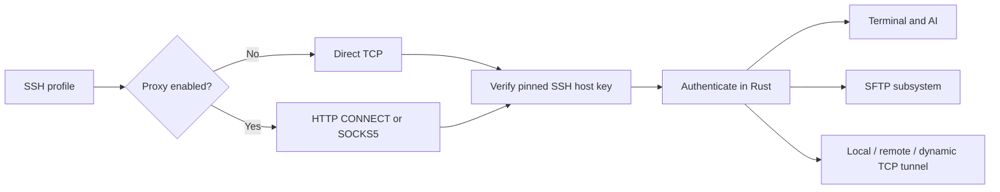

# ADR-0007: SFTP, TCP forwarding, and SSH proxies

Status: implemented in 0.2.0.

Selai uses its existing russh transport and pinned server keys for terminal,
agent, file, and tunnel connections. The UI chooses a saved SSH profile; it
does not receive passwords or private keys to establish a connection.

Proxy and tunnel metadata live in `network_profiles` in the encrypted database
(schema 9). `host_proxies` records an SSH profile's selected route. Proxy
passwords use the existing `SecretStore` under `proxy/<id>/password` and are
write-only over IPC. A proxy cannot be deleted while an active SSH profile uses
it. Archiving an SSH profile removes its route assignment.

HTTP proxies use CONNECT with optional Basic authentication. SOCKS5 supports
no authentication or username/password and delegates destination DNS to the
proxy. Every SSH path, including host-key probing and AI tasks, uses this route.
Proxy acceptance never bypasses the SSH pin check. Arbitrary ProxyCommand shell
commands are not executed.

SFTP connections are independent of terminal tabs and survive switching or
closing the SFTP page. Reopening the page restores its connection and subscribes
to current transfer state. File contents stay in Rust: transfers use a 64 KiB
copy buffer and at most two concurrent jobs. IPC carries paths and throttled
progress (at most approximately ten events per second per streaming transfer).
The UI virtualizes file rows. Listings stop at 20,000 entries; a recursive plan
stops at 100,000 entries. At most 32 jobs can queue and 100 recent states are
retained in memory. Transfer state is not persisted across application restarts.

Folders are copied recursively. Symlinks are skipped to avoid following a tree
outside the selected source or looping. Downloads reject names that are unsafe
on Windows. New files are streamed to unique sibling temporary files; they are
published only after the copy succeeds. Matching files are skipped by default.
Replacement requires an explicit UI confirmation. A remote replacement retains
a temporary backup until the final rename succeeds. Cancellation removes the
current temporary file when the server/filesystem is reachable. Completed files
and directories are retained; partial transfers are not resumed automatically.

Each tunnel owns a separate SSH session, listener, and child connections.
Local forwarding uses direct-tcpip channels. Remote forwarding requests a server
listener and accepts forwarded-tcpip channels only for its configured port.
Dynamic forwarding implements a SOCKS5 TCP CONNECT listener; UDP and SOCKS4 are
not supported. Listeners default to loopback. Port 0 requests an available port.
The UI shows the actual port, active connections, byte counts, and failures.
At most 16 tunnels and 64 connections per tunnel can be active. Copies use
bounded buffers and TCP backpressure. Stopping aborts child connections and
releases the listener. Saved tunnels never start automatically.

Vault locking prevents new network operations, then seals the database while
retaining established SFTP sessions, active transfers, and tunnel listeners in
memory. Transfers and live tunnels may continue reading/writing or carrying
traffic while locked. Unlocking reattaches the network pages to the retained
registry; quitting Selai closes these sessions. No connection is recreated
after a process restart.

Validation includes real OpenSSH forwarding in all three modes, HTTP and SOCKS5
relay authentication with unchanged SSH pin verification, recursive SFTP
round trips, replacement/skip behavior, cancellation cleanup, Windows filename
validation, and frontend flows. See `network_integration.rs`, `network_e2e.rs`,
and `NetworkPages.test.tsx`.
